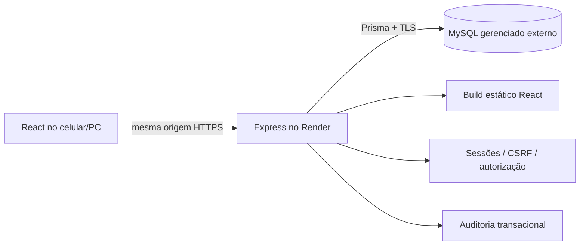

# Arquitetura e segurança

## Fluxo e decisões

Monorepositório npm workspaces; API REST Express 5; schemas compartilhados em Zod; rules package isolado. Produção usa um serviço Render para servir frontend compilado e `/api`, evitando cookies entre sites e CORS com credenciais. Em desenvolvimento o proxy Vite mantém a mesma origem do navegador. Nenhuma API usa arquivos JSON como persistência.

MySQL 8.4/InnoDB, Prisma 7 com adaptador MariaDB compatível com MySQL. IDs UUID; login ASCII canônico único; nome de personagem não único. Relações essenciais usam RESTRICT para impedir perda acidental de fichas/logs. Sessões e códigos usam CASCADE se um usuário for eliminado por procedimento futuro apropriado. A aplicação não expõe exclusão física de usuários/campanhas/personagens: disabledAt/archivedAt são a base para desativação/arquivamento. A política de retenção e anonimização precisa ser definida antes de abrir exclusões administrativas.

Os 17 modelos solicitados e privilege_invites estão no schema. Audit logs são append-only na aplicação (sem updatedAt intencionalmente); cada log tem createdAt e referência ao ator. O usuário SQL de produção não deve poder atualizar/apagar logs. As demais entidades têm createdAt/updatedAt; entidades de domínio editáveis têm version. Restrições SQL exigem version>=1 e quantidade de inventário>=0; não há limites de mecânicas presumidos.

## Permissões

- GlobalRole: ADMIN ou PLAYER. O ADMIN continua podendo criar personagens próprios.
- `canCreateCampaigns`: habilitação global de criação, concedida por convite de mestre ou CLI do ADMIN inicial.
- CampaignMember.role: GM ou PLAYER por campanha. Habilitação global não autoriza ler/editar fichas de todas as campanhas.
- Rotas legadas mantêm propriedade. Rotas detalhadas da Parte 2 autorizam dono ou GM vinculado à campanha ativa. ADMIN sem vínculo não acessa fichas de terceiros. Compartilhamento com colegas/painel de campanhas permanecem na Parte 3.
- DTOs estritos não aceitam ownerId, role, status, atributos ou permissões vindos do navegador.
- Projeções explícitas evitam envio de passwordHash, recovery_codes e hashes de convites. Segredos futuros do mestre exigirão projeções diferentes e testes de ausência de campos.

## Credenciais e sessões

Senhas de 12–128 caracteres, Argon2id (64 MiB, t=3, p=1). Não há e-mails nem e-mails artificiais. Login é minúsculo; nome de personagem é independente. Mensagem de falha de login é genérica; custo de verificação para usuário inexistente usa hash de referência. Conflito no cadastro pode revelar que um login existe, aceitável para nomes públicos únicos; recuperação tem mensagem genérica.

Sessão: 32 bytes aleatórios, só SHA-256 do segredo no banco (não se aplica a senhas). Cookie HttpOnly, SameSite=Lax, Secure e prefixo __Host em produção, sem Domain. Expiração absoluta 7 dias e inatividade 12h, ambas verificadas no servidor. Login rotaciona a sessão do navegador; logout apaga sessão; recuperação revoga todas. Sem tokens de autenticação no localStorage. TanStack mantém apenas dados públicos em memória. Respostas API usam Cache-Control:no-store.

CSRF: token aleatório assinado HMAC-SHA256, cookie HttpOnly, valor retornado por GET `/auth/csrf`; frontend envia em X-CSRF-Token. Todas as mutações, inclusive login/cadastro/logout, exigem igualdade com cookie, assinatura válida e Origin exata configurada. Nenhum CORS permissivo é habilitado. SameSite é camada adicional. CSRF_SECRET deve ter pelo menos 32 caracteres aleatórios e ser configurado fora do código.

Limites: 600 requests por IP/15min na API; 40 por IP/15min em auth; 12 tentativas de cadastro/login/recuperação por nome normalizado/15min; identidade da chave por hash em memória. Isso limita adivinhação, mas o armazenamento padrão é local ao processo. Antes de escalar para múltiplas instâncias, adotar armazenamento de rate limit compartilhado e limitação no gateway. Configurar TRUST_PROXY=1 somente com a topologia de um proxy Render validada; caso contrário IPs podem ser falsificados ou todos agrupados.

Convite de mestre: 256 bits, uso único, validade máxima de 7 dias, padrão UI 24h; hash no banco; consumo condicional na mesma transação do cadastro; revogação por ADMIN e registro de auditoria. Não existe chave administrativa no frontend. Um código inválido informado resulta em erro explícito e nenhuma conta criada; o usuário pode remover o campo e cadastrar como PLAYER. Não há matrícula pública livre de mestres.

Recuperação: 8 códigos de 256 bits apresentados uma vez; hashes no banco e usedAt atômico. Não aparecem em logs ou consultas posteriores. Download local é opcional e deve ser guardado pelo próprio usuário. Se a transação de cadastro concluir mas a resposta se perder, não há reexibição dos códigos; usar o procedimento administrativo de verificação. O sistema não promete recuperar credenciais sem verificar identidade.

Primeiro ADMIN: CLI em terminal seguro, senha oculta, bootstrapKey única para impedir duas criações concorrentes. O operador do servidor é a fronteira de confiança. Não existe endpoint de bootstrap nem segredo permanente no React. `admin:recover` exige operador com acesso ao servidor, conta ADMIN ativa e declaração de verificação presencial/voz por contato anteriormente conhecido. Registra referência sem documentos/senhas e invalida sessões/códigos antigos. Não confia somente no nome do personagem ou em quem consegue abrir o formulário.

## Concorrência e auditoria

PATCH usa versão enviada pelo formulário e WHERE id/ownerId/version. Somente um UPDATE vence. Incremento e log pertencem à mesma transação. Um 409 não substitui o texto local; UI permite copiar e carregar a versão do servidor explicitamente. Leitura indica carregado, não salvo. Persistência confirmada aparece só no onSuccess do PATCH.

A Parte 2 implementa autosave textual com debounce de 850 ms e operações imediatas por domínio. Rascunhos textuais não confirmados ficam em memória por conta/ficha; navegação interna preserva esse estado, e fechar/recarregar exibe aviso. Não há fila offline persistente nem sincronização em tempo real. Limites e controle de versões independentes estão em FICHA_DIGITAL.md.

## Limites antes da produção

HTTPS/TLS reais, banco gerenciado, restauração, carga, acessibilidade completa e browsers adicionais precisam ser verificados em staging. Backups e monitoramento não são criados pela existência de docs. Ainda faltam gestão completa de contas, campanhas e aprovações. Mecânicas explícitas da Parte 2 foram implementadas; o manual completo e exemplos homologados por Marcus continuam pendentes.

## Ampliação da Parte 2

Ficha, regras e API foram acrescentadas sem recriar a autenticação. sheet-routes.ts valida DTOs e sheet-service.ts autoriza/serializa transações. Cada domínio tem versão independente e Character.version mantém a sequência de auditoria. operationId/requestHash preserva idempotência e protege gasto duplo. CSRF no navegador usa inicialização compartilhada entre requests simultâneos.

As rotas detalhadas autorizam proprietário ou GM de campanha ativa, nunca ADMIN universal. Só GM vinculado configura política de fadiga e autoriza repetição contextual. Operações legadas permanecem limitadas ao proprietário. Não há endpoint público de aprovação definitiva.

Novas tabelas: character_condition_states, character_operations e dice_rolls; modelos existentes ampliados para narrativas, espaços/equipamentos e antes/depois em auditoria. Máximos são derivados. Ver FICHA_DIGITAL.md e migração 202610300002_interactive_sheet.
